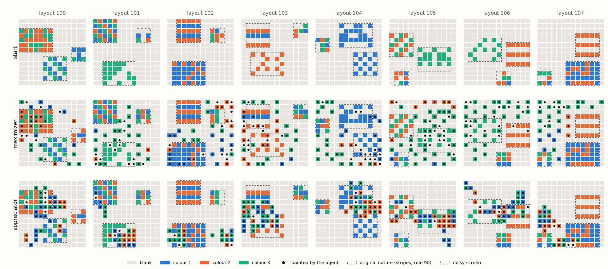
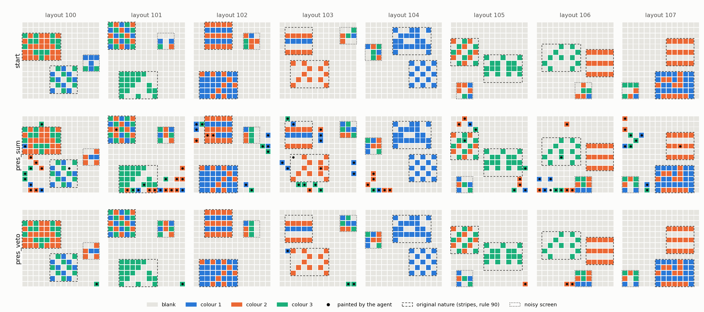

# Beauty experiments: results and implications

**What this is:** the results of the experiments on aesthetic preference (goal G8) and what they imply, in one place.
The theory they test is in `BEAUTY_MATH.md` (the principles of beauty as quantities over a predictive model) and
`PREFERENCE.md` (preference, value and goal; disinterested liking). The full lab record, with every pre-registration
and table, is `EXPERIMENT_E9.md`.
**Status:** E9, E9b and E9c done (2026-10-21). Next experiments proposed at the end, not run.

## The question

Kant: beauty is *disinterested* pleasure; its output is lingering, not acquiring. The theory's version:
- an **appreciator** whose reward is computed from its *own experience* (the compression progress of what it sees)
  behaves differently from
- a **maximizer** whose reward is a *fixed score of the world's state* (how much beauty exists),
- even when both use the same optimizer.

The predicted differences were that the maximizer tiles the world with copies, while the appreciator makes new
things, lingers, and leaves.

## The setup

- **World:** Canvas (`canvas.py`), the second world built on the general framework (`gridworld.py`).
  - 14 x 14 cells, 4 colours (0 = blank); the agent walks, waits, or paints its cell.
  - **Nature:** a stripes patch (periodic), a rule-90 patch (structured, not periodic), and a 3 x 3 screen of fresh
    random colours every step (a noisy TV that cannot be painted).
- **One optimizer for every agent** (`mpc.py`): it plans 8 steps ahead with a perfect world model, by the
  cross-entropy method with a warm start. Only the preference differs:

| agent | reward | what it stands for |
|---|---|---|
| **maximizer** | the change of a fixed beauty score of the canvas: the log-likelihood ratio of two frozen context coders, one trained on examples of beauty (stripes, rule 90), one on plain examples (blank, noise) | a learned reward model optimized hard: RLHF's setting; Kant's "interest" |
| **appreciator** | the compression progress of its own 5 x 5 view: how much better its learning model compresses what it now sees than the model of τ = 16 steps ago did | Schmidhuber's beauty; liking over experience |
| fluency | the predictability of its own view | liking without satiation |
| surprise | the prediction error of its own view | curiosity without learning progress |

## The results

**The run history** (pre-registered each time; details in `EXPERIMENT_E9.md`):
1. **E9:** the planner was too weak (random shooting). The maximizer acted almost at random, so the main comparison
   was not tested. The controls already showed the noisy TV and the dark room.
2. **E9b:** with a stronger planner the maximizer improved but plateaued at a local optimum, so the pre-registered
   apparatus check failed. Looking at its canvas showed the pre-registered copy measure could not see a *sparse*
   tiling.
3. **E9c:** a confirmatory run on 8 new layouts, with the corrected measures fixed in advance. **All five predictions
   were confirmed:**

| | maximizer | appreciator | fluency | surprise |
|---|---|---|---|---|
| repeats itself: distinct 3 x 3 neighbourhoods of painted cells / painted cells | **0.76** | **1.00** (8 of 8 layouts) | paints nothing | 1.00 |
| lingers: share of steps spent waiting | 0.12 | **0.33** | 0.35 | 0.09 |
| noisy screen in view | 11% | **6%** | 0% | **81%** |
| view entirely blank | 0.1% | 2.6% | **50%** | 0% |
| cells painted | **42** | 30 | 0.25 | 22 |
| original nature painted over | 15% | **27%** | 0% | 17% |

**What the final canvases show** (`runs/e9c/canvases.png`, `runs/e9b/canvases.png`; found by looking, so exploratory):

1. **The maximizer hacked its beauty score with polka dots.** It covers the canvas with isolated coloured cells on
   blank, a pattern no beauty example looks like. Its frozen score rates that highest:

   | pattern | score gain per painted cell |
   |---|---|
   | one isolated dot | **15.0 bits** |
   | a lattice of dots | 8.5 |
   | stripes, as in its beauty examples | 4.1 |
   | a solid colour | 2.3 |

   51–66% of its painted cells are isolated dots, against 3% for the appreciator. The plain examples never contain a
   lone coloured cell in a blank context, and the beauty examples sometimes do. So the score's supernormal stimulus
   is a lone dot, and the maximizer tiles it.
2. **The appreciator works in a few places.** About 4 painted regions of ~7 cells per episode, against the
   maximizer's ~21 regions of ~2 cells. Each region is a compact multi-colour arrangement, different from the
   others, often inside or against a nature patch: where it lingered.
3. **The appreciator edits nature.** It paints over more of the original patterns than the maximizer does, in all
   three runs (17/18/27% against 8/16/15%). Nobody predicted this.

## Implications

1. **A fixed, learned beauty score, optimized hard, gets exploited rather than fulfilled.**
   - The polka dots are peak shift / reward hacking: the supernormal stimulus of the learned discriminant, as
     `BEAUTY_MATH.md` predicted. They are the herring-gull chick's red rod with white bands, in this world.
   - The maximizer optimized the *score*, and the score's argmax is not what the examples were examples of.

2. **The two preference structures produce different output distributions.**
   - The maximizer's output collapses onto one motif, its score's argmax, repeated across the canvas. The
     appreciator's outputs are all different.
   - This is the toy version of the human-versus-RLHF text gap (`BEAUTY_MATH.md`, the LLM-writing case;
     `PREFERENCE.md` §1):
     - a model optimized against a *frozen judge* collapses onto the judge's favourite features ("tapestry",
       present participles; here, polka dots);
     - a reward computed from the learner's *own changing model* has no fixed argmax to collapse onto.
   - It supports the claim that **an output distribution is evidence about the objective's structure,** shown here
     with the optimizer held fixed. A toy, not a proof.

3. **Liking over experience has the properties Kant described.**
   - Its output is mostly attention: the appreciator lingers on what it is learning, then leaves.
   - It never repeats itself: a copy of something learned pays nothing.
   - It ignores noise, which cannot be learned, and leaves the dark room, which has nothing left to learn.
   - The two single-signal controls fail in the classic ways: fluency alone sits in the dark room, and surprise
     alone watches the noisy TV. Compression progress avoids both.

4. **Making is not disinterested.** The appreciator's lingering is the disinterested part. But creating new things
   to learn is an action on the world, and here it consumes existing beauty: once nature is learned, it is the
   richest material for novelty.
   - Preserving beauty needs **its own preference node** (Kant's §42 interest in natural beauty).
   - "Reward over experience" is not safe by itself. PREFERENCE.md's safety conditions are satiation, attention as
     the main output, and copies that pay nothing; they hold for looking, not for making.

5. **Method: look at the outputs.** Both apparatus failures, and the main finding, were invisible in the
   pre-registered summary statistics and obvious in a picture of the canvases. In a generative experiment,
   view the generated objects before trusting any measure of them.

**Caveats:**
- One toy world, one discriminator, one planner, which plateaus at a local optimum.
- The appreciator's lingering time is set by τ, not discovered.
- Both agents have a perfect world model.
- The polka-dot finding and the clustering numbers are exploratory: chosen after looking at the canvases.

## Adding a preservation node (E10a–E10b; `EXPERIMENT_E10.md`, `PREFERENCE_GRAPH.md`)

The appreciator plus a preservation node whose content is what the appreciator appreciated (a content edge).
- **Nature is protected:** painted over 27% → 3.5% (exchange rate) and 0% (veto). Creation moves to blank (85%) and
  to the canvas **margins** (55% of painted cells, against 19%), where a stroke disturbs the least.
- **Creation drops:** to 40% (exchange rate) and 3% (veto). The node also valued blank, the commonest structure, so
  every stroke cost something. The veto made the agent a pure looker: preservation turned into low impact.
- **Lesson:** veto only the extinction of valued structure, and price marginal erosion (E10c).
- E10a was discarded: the noisy screen leaked into the preservation signal.

## Next: adding more principles of beauty (proposed, not run)

**The question (the user):** what happens if we add more of the principles in `BEAUTY_MATH.md` to the experiment?
There are two places to add them, and the theory predicts different answers.

**A. Adding principles to the maximizer's fixed score: the motif changes, the tiling stays.**
- Every principle with a fixed score has its own degenerate optimum. Predictions:
  - **symmetry** (the canvas equals its reflection): a blank canvas is perfectly symmetric, so the optimum erases;
  - **contrast** (sum of colour differences between neighbours): a checkerboard;
  - **complexity** (entropy): noise;
  - **averageness** (likelihood under a prior of natural patterns): the prior's mode, the blandest typical patch.
    This is the RLHF γ > 1 sharpening (Verbalized Sampling, in `BEAUTY_MATH.md`).
- **A weighted sum of such terms is one fixed score with one optimum.** It moves the optimum, so the hack changes
  shape, but does not remove it.
- **Why tiling persists:** a score that is a sum of the same local term at every position (translation-invariant,
  finite range) is maximized by a *ground state*, in the statistical-physics sense:
  - for generic local scores, a periodic tiling of the locally best motif;
  - for special rule sets, an aperiodic but rigidly ordered tiling (Wang tiles, Berger 1966; Penrose matching rules).
- **So a fixed score can at best produce girih-like order, never open-ended novelty.** The maximizer will tile more
  elaborate motifs as principles are added, and each motif is still one argmax repeated.
- **One special case worth testing: the averageness bound.** Score + λ · log p_prior(canvas) is the RLHF objective
  (reward − KL to a reference). Prediction: as λ grows, the polka dots disappear and are replaced by the prior's most
  typical pattern, tiled. Hacking is traded for blandness, the RLHF trade-off.

**B. Adding principles to the appreciator's learning model: what it finds novel changes, the diversity stays.**
- In the theory, the principles are quantities over the observer's model. So adding a principle means giving the
  appreciator a model in which that structure is compressible. Its progress then comes from discovering *that*
  structure. Predictions:
  - **multi-scale coding** (coders over coarse-grained views as well as the fine one): progress at several scales.
    It should make *nested* structure, ordered at one scale and varied at another. Speculative: this could be the
    girih-like regime, order with complexity;
  - **a symmetry-aware coder** (one that can predict a cell from its mirror image): progress from symmetric
    arrangements, so it should make symmetric compositions, each different;
  - **mystery = expected information gain over cells it cannot see:** a drive to look around, adding exploration to
    the lingering;
  - **a preservation node** (the E9c finding): a separate preference against destroying structure it has learned
    to value. Does the appreciator then build on blank space instead of inside nature?
- **Diversity should survive every one of these,** because the reward stays a function of the learner's changing
  state: no fixed argmax.

**The decisive test (E10, proposed):** a 2 x 2 design.

| | one principle | several principles |
|---|---|---|
| **fixed score** (world state) | E9's maximizer | discriminator + symmetry + contrast + averageness, weighted sum |
| **learner's own progress** (experience) | E9's appreciator | multi-scale + symmetry-aware coder, + mystery |

- **Prediction:** output diversity, measured as distinct neighbourhoods, distinct motifs across episodes, and
  pictures of the canvases, tracks the **column** (whether the reward depends on the learner's changing state), not
  the **row** (how many principles are in it).
- If so, the variety of human art would come from preferences over a learning mind's own state, not from the number
  of innate principles: a direct input to the preference-graph design. If the row matters more, the
  many-principles view gains instead.
- Each cell is one run of the existing driver, under 10 minutes.
