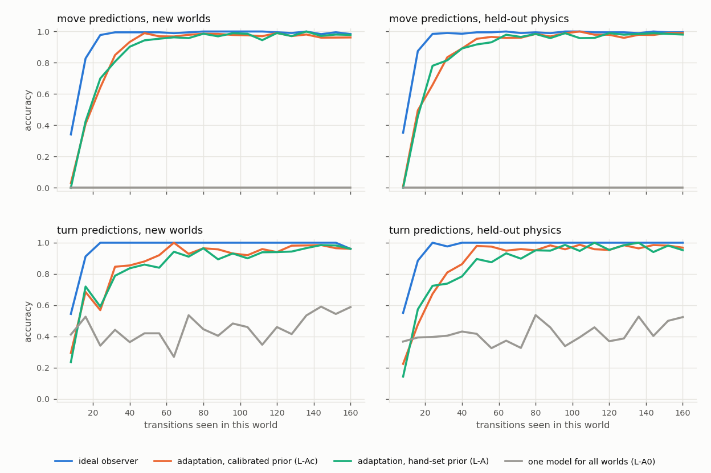

# E12: data efficiency against the ideal

**Question (the user):** can we measure the data efficiency of our microworld experiments? Our worlds' rules are
known, so a learner can be compared with an **ideal Bayesian observer** on the same data: something impossible at
language-model scale. Context: the user's thesis that data efficiency is blocked by continual learning (in-context
learning is data-efficient, but cannot be consolidated into weights without forgetting).

## E12a, pre-registered (2026-10-23): the ideal observer for robot motion in the E8 world family

**What is measured.** E8's hidden physics carries about 36.4 bits per world. The largest block is the **action
permutation** (8! = 40,320, 15.3 bits): which action index moves the robot which way. Robot motion also depends on
which shown terrain code is the walkable fire (7 possibilities) and on the push rule (push / block / swap).

**The ideal observer** (`ideal_observer.py`):
- exact Bayes over the joint space perm × fire code × push rule (846,720 hypotheses), with a uniform prior;
- each step it sees what E8's model sees (the observation, the action index, the next observation) and keeps the
  hypotheses whose predicted robot motion matches the observed one. Robot motion is deterministic given the
  hypothesis, so this is the exact posterior;
- its prediction is the posterior predictive's most probable robot outcome;
- one known simplification: when a push would move a villager onto a terrain code whose role is still unknown (it
  could be the pit), the step is treated as uninformative. Such steps are rare. This can only make the observer
  slightly worse than ideal, so the measured gap is a lower bound.

**Scored like the model:**
- the same 64 test and 64 held-out 512-step worlds as E8c (`runs/data_family_long`);
- the same move and turn instances (`village_events` labels);
- the same 8-step chunks;
- the model's per-chunk accuracy curves are read from the E8c logs (`runs/e8/*/log.jsonl`, the end evaluation).

**Apparatus check:** in every world, the true hypothesis (regenerated from the world's seed) must stay consistent at
every step.

**Predictions:**

| # | prediction |
|---|---|
| D1 | The ideal observer is ≥ 99% accurate on move and on turn from chunk 4 on (after 32 transitions), on both splits |
| D2 | E8c's best model (L-Ac, adaptation with the calibrated prior) needs ≥ 10× as many transitions as the ideal to first reach 95% move accuracy |
| D3 | The true hypothesis stays consistent at every step in all 128 worlds |

## E12a results (2026-10-23; 128 worlds, 4 min; `runs/e12.txt`, `runs/e12/ideal_vs_model.json`, figure `runs/e12/ideal_vs_model.png`)

Transitions needed in a new world to first reach a level of accuracy (chunks of 8):

| | move 90% | move 95% | move 99% | turn 95% | turn 99% |
|---|---|---|---|---|---|
| **ideal observer**, new worlds / held-out physics | 24 / 24 | 24 / 24 | 32 / 32 | 24 / 24 | 24 / 24 |
| **L-Ac** (adaptation, calibrated prior) | 40 / 48 | 48 / 48 | 120 / 104 | 64 / 48 | 64 / 168 |
| L-A (adaptation, hand-set prior) | 40 / 48 | 56 / 64 | 120 / 168 | 80 / 80 | 168 / 112 |
| L-A0 (one model for all worlds) | never | never | never | never | never |

- **The ideal observer's information:**
  - uncertainty over the motion-relevant physics falls from 19.7 bits to 8.2–8.4 after 32 transitions, and 6.3–6.4 at
    the end;
  - the remainder is never needed for motion: for example, which of the four non-moving actions is which (4.6 bits),
    and the fire code and push rule in worlds with no fire or no villager contact;
  - its prediction cost for robot motion is 13–17 bits over a whole world, most of it in the first 16 transitions.
- **The one-size model never predicts a move** (0%): the action permutation is world-specific.

| # | verdict |
|---|---|
| D1 | **Confirmed pooled:** after 32 transitions the ideal observer is 99.7% (move) and 99.9–100% (turn) accurate. Single chunks dip to 96–98% when a robot first meets fire or a villager, which no observer can predict before it happens |
| D2 | **Refuted:** L-Ac needs only **2×** the ideal's transitions to reach 95% move accuracy (48 against 24), 2–2.7× for turns, and 3–7× for 99% |
| D3 | **Confirmed:** the true hypothesis stayed consistent at every step in all 128 worlds |

**Reading.**
- **In-world learning with a learned prior is close to ideal:** within 2× at the 95% level, 3–7× at 99%. The fast,
  in-world part is not the data-efficiency problem here.
- **The expensive part is the prior:** 1,260 s of meta-training over thousands of worlds (E8c). That matches the
  user's thesis.
  - The in-world learning (fast weights, an in-context-like mechanism) is efficient because a prior was paid for.
  - Nothing learned in one world is *kept*: the fast weights are discarded after every world, by design.
  - Consolidating in-world knowledge into weights, and keeping it across a stream, is untested.
- **The natural next yardsticks:**
  - an ideal observer *with memory of earlier worlds*, which identifies a recurring world from about log2(worlds
    seen) bits instead of re-learning ~20 bits of motion physics;
  - a continual stream of rules, with forgetting measured (backward and forward transfer).
